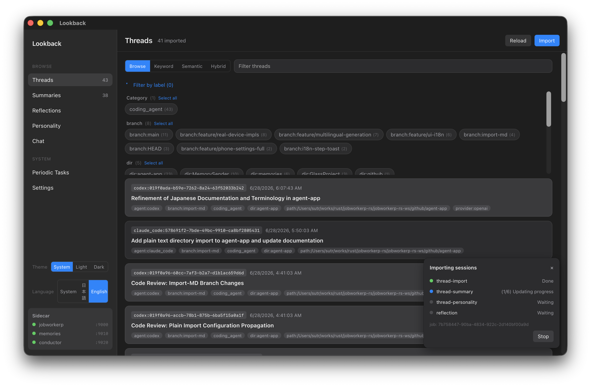

# Lookback

Lookback is a cross-platform Tauri desktop app for turning local Claude Code and Codex session logs into searchable long-term memory.

It imports session logs into [`memory-store`](https://github.com/jobworkerp-rs/memory-store), then lets you browse threads, generate summaries and reflections, inspect personality signals, and ask RAG questions from a desktop UI.

Japanese documentation is available in [README_ja.md](README_ja.md). Developer-focused setup, test, and environment details are in [docs/developer-guide.md](docs/developer-guide.md).

## Screenshot



## What You Can Do

- Import local `claude-code` and `codex` session logs.
- Import plain text (`.md` / `.txt`) from a directory as threads, grouping per file, per directory, or as a single thread.
- Browse imported threads and search them by keyword, semantic search, or hybrid search.
- Generate thread-group, daily, weekly, and monthly public summaries. Per-thread summaries remain internal inputs for period and group generation.
- Generate reflections and personality profiles from past sessions.
- Ask questions against imported memory from the Chat tab.
- Expose the RAG recall tool to external MCP clients.
- Schedule periodic import and summary tasks through the bundled conductor backend.

## Supported Platforms

Lookback targets Tauri-supported desktop platforms. The current repository is set up for macOS and Linux builds.

Local LLM execution currently supports only Qwen 3.5/3.6-family and Gemma 4-family models. The default local preset is the non-MTP Gemma 4 E2B IT QAT preset because Lookback summarizes before chat; MTP presets remain available for chat-focused use. Gemma 4 MTP initializes the runner with the QAT target GGUF plus a separate draft GGUF. Use an external LLM provider for other model families.

## Required Components

The app UI lives in this repository, but running the complete desktop app also needs bundled backend binaries and jobworkerp plugins:

- [`jobworkerp`](https://github.com/jobworkerp-rs/jobworkerp-rs): `all-in-one`
- [`memory-store`](https://github.com/jobworkerp-rs/memory-store): `front`, `memories-import`, and
  the official SQLite migration bundle (`memories-db-migrate`, Atlas, and the migration catalog)
- [`jobworkerp-conductor`](https://github.com/jobworkerp-rs/jobworkerp-conductor): `conductor-main`
- [`issue-tracker-server`](https://github.com/sutr-app/issue-tracker-server): Issue Tracker sidecar
- Runtime `protoc`: the official self-contained protobuf compiler, fetched automatically by the build
  (children run it to compile runner schemas at worker-registration time, so it is shipped as a
  bundled binary)
- [`llama-cpp-runner`](https://github.com/jobworkerp-rs/llama-cpp-runner): local LLM runner plugin
- [`mm-embedding-runner`](https://github.com/jobworkerp-rs/mm-embedding-runner): embedding runner plugin

Frontend checks can run without these binaries. Running the complete app, importing logs, loading models, and building distributable packages require them.

### Database migration at startup

If the local memories database needs migration, the startup screen says that Lookback is checking or migrating the database. Do not quit or restart Lookback until it finishes. Startups that need no migration only run a quick check and do not show this indication.

Before a migration changes the database, the bundled migration tool backs it up into `<data root>/database-migration-backups/`. Settings > Advanced > "Backup before database migration" controls whether that backup is taken and how many are kept. If a migration fails, the startup screen explains the cause and offers the matching action (retry, restore the backup, start with a new empty data location, or upgrade through an older release); see [the Japanese operations guide](docs/database-migration_ja.md) for details.

## Build From Source

### Prerequisites

Install these on the build host before building:

- Rust toolchain compatible with edition 2024 (rustc >= 1.85), installed via `rustup`.
- Node.js and `pnpm`.
- Tauri v2 prerequisites for your OS.
- Build tools used by the backend repositories and their native dependencies:
  `git`, `cmake`, `pkg-config`, host `protoc`, `jq`, and `curl` / `unzip` / `tar`. Release builds
  require host `protoc` and `jq` on `PATH` for protobuf compilation and migration-bundle generation.
  Separately, the build downloads a pinned, self-contained `protoc` executable to bundle for runtime;
  `PROTOC` can override development staging, but does not satisfy the release build's host `protoc`
  check.
  - macOS: Xcode Command Line Tools (`xcode-select --install`) and, via Homebrew,
    `brew install protobuf cmake pkgconf jq`.
  - Linux (Debian/Ubuntu): `apt-get install -y build-essential git cmake pkg-config protobuf-compiler jq curl unzip tar`.
- For a CUDA build on Linux: the CUDA toolkit (`nvcc`); `libcudnn` / `libnccl` for the full runtime.

### Automated build (recommended)

`scripts/build-release.sh` clones the six public backend repositories, builds them with the
right features for your platform and GPU backend, stages the binaries / plugins / lindera
dictionary, generates the official SQLite migration bundle from the same memory-store checkout
as `front`, and runs `pnpm tauri build`:

```bash
# macOS (Metal GPU, DMG + .app)
scripts/build-release.sh --profile mac

# Linux (CUDA GPU, deb + AppImage)
scripts/build-release.sh --profile linux-cuda
```

Useful flags: `--skip-clone` (reuse existing clones), `--only <repos>` (rebuild a subset),
`--workdir <dir>` (clone/build location, default `.build-deps/`), `--skip-frontend`,
`--lindera skip`. Run `scripts/build-release.sh --help` for the full list, or prefix with
`DRY_RUN=1` to preview the commands without running them.

The generated package, such as a macOS `.app` / DMG or a Linux package target, includes the UI,
workers, optional search dictionary files, plugins, and bundled backend binaries according to
`src-tauri/tauri.conf.json`.

### Manual build

If you build the backend components yourself, pre-stage the outputs below, then run
`pnpm install && pnpm tauri:build`. Packaging commands do not invoke development staging or
generate a migration bundle; the pinned release inputs and provenance must already be present.
For the complete pinned build-and-stage flow, use `scripts/build-release.sh` instead.

1. Put the backend binaries in `src-tauri/bin/` with the target-triple suffix Tauri expects
   (such as `-aarch64-apple-darwin`, `-x86_64-apple-darwin`, or the Linux target triple; add
   `.exe` on Windows):

   ```text
   src-tauri/bin/all-in-one-<triple>
   src-tauri/bin/front-<triple>
   src-tauri/bin/conductor-main-<triple>
   src-tauri/bin/issue-tracker-server-<triple>
   src-tauri/bin/memories-import-<triple>
   src-tauri/bin/protoc-<triple>
   ```

2. Generate the official SQLite migration bundle from the same pinned Memories checkout used to
   build `front` and `memories-import`. The upstream bundle script creates the static bundle, but
   that output is not by itself ready for packaging; do not replace an existing staged bundle
   until its provenance and target artifacts have passed the strict check.

   A structurally valid bundle alone is not package-ready: its
   `memories-source-provenance.json` must be produced from that clean pinned checkout, and its
   recorded `front` / `memories-import` hashes must match the target-suffixed binaries in
   `src-tauri/bin/`. Record it with
   `scripts/lib/write-migration-source-provenance.mjs`, using the release-pinned ref/revision and
   those staged binaries, then run `pnpm verify:packaging-migration`. `pnpm tauri:build`,
   `pnpm tauri build`, and direct Tauri build/bundle commands enforce this strict check; they
   reject missing provenance or mismatched artifacts instead of falling back to development
   staging.

3. Build the runner plugins (`libjobworkerp_llama_cpp_plugin` and
   `libmm_embedding_runner`) for your target OS and place the shared libraries
   under `plugins/`. `issue-tracker-server` is staged as a standalone external
   binary; it is not a runner plugin.
4. If your `memory-store` `front` build uses Lindera FTS, place the search dictionary under
   `dict/lindera/ipadic` (lindera 3.x format with `metadata.json`). Lookback packages and stages
   this directory for `memory-store`; it does not load the dictionary directly.

For development launch commands and path overrides, see [docs/developer-guide.md](docs/developer-guide.md).

## First Run Tutorial

1. Start Lookback.
2. Complete the setup wizard:
   - Choose the data root and Hugging Face cache location.
   - Choose a local or external LLM provider.
     - External LLM API keys are stored in the OS credential store, such as Keychain.
   - Choose the embedding model.
   - Confirm the backend and model readiness checks.
3. Open **Settings** later if you need to change providers, model paths, cache paths, language, timezone, or MCP exposure.
   - **Embedding model** remains editable when Connection sets memories to **Remote server**. For semantic or hybrid search, local article embeddings are not generated, so match the local query embedding model and vector dimension to the remote server embeddings. Changes while memories is remote do not reset or regenerate the local embedding index. Local memories SQLite/LanceDB is neither started nor read; all memories reads and writes use the remote endpoint. Startup verifies required memories services and list/count schemas through gRPC Server Reflection: the remote must support the `memory_kinds` filters and `external_id_prefix` fields on memory summary list/count requests, the `memory_kinds` filters for thread-label RPCs, and expose Reflection v1. Deploy a matching updated memories binary; older binaries are rejected because they can mix non-RAW labels or different summary kinds into a tab.
   - **Timezone** controls the wall-clock boundaries used by summaries, imports, and timestamp display. **Auto** follows the app environment / OS timezone; saving an explicit timezone restarts the sidecar because worker processes read `TZ` at startup. This setting is disabled while Connection sets jobworkerp to **Remote server** because the remote workflows use the remote server environment.
4. Open **Threads** and click **Import** to import Claude Code or Codex session logs. To import a directory of plain text instead, check **Plain text (directory)**, choose the target directory, and pick a thread split strategy:
   - **Per file**: one thread per file.
   - **Per directory**: files in the same directory become one thread.
   - **Single thread**: the whole directory becomes one thread.

   Plain import reads `.md` / `.txt` files recursively. An optional **Source name** (`a-z0-9_-`, up to 32 chars) namespaces the imported threads; leave it empty to use the importer default. Plain text can be imported together with Claude Code / Codex in the same run.

   Manual imports check `~/.claude/projects` and `~/.codex/sessions` independently and skip a selected source whose directory is absent. If no selected auto-discovered log source is available, the import is still reported as a successful no-op and the progress panel at the top of Threads explains the condition. A missing directory selected for Plain text remains an error. Periodic regular tasks perform the same per-source check before importing: unavailable Codex or Claude Code roots are skipped and listed in `skipped_import_sources`, while the configured summary and generation stages still run.
   The progress panel at the top of Threads shows thread summary and thread-group summary as separate stages before personality and reflection. Both summary stages show the current item and total count while processing; the import can be cancelled from the Threads toolbar while group summaries are running.
5. Browse imported threads from **Threads**. In the group view, each thread-tree card shows that member thread's summary (not the separate group summary); its labeled action opens the corresponding conversation. Use keyword search first; use semantic or hybrid search when the embedding runner is ready.
6. Open **Summaries** to generate or inspect thread-group and period summaries. Per-thread summaries are internal generation inputs and are not shown in the list, search, or selection UI.
7. Open **Reflections** and **Personality** to generate higher-level observations from imported sessions.
8. Open **Chat** and ask questions about your imported history. Source links in answers take you back to the relevant threads or summaries.
9. Open **Periodic Tasks** if you want Lookback to import and summarize on a schedule.

## Same-thread Issue resolution

When experimental Issues are enabled, Lookback can reconcile an existing unreviewed Candidate or automatically registered Issue against later messages in its source thread. Human-reviewed, edited, or claimed targets are protected.

1. In **Settings**, save the Issue policy with **Issue resolution mode** set to `APPLY`. This is independent of new Candidate extraction.
2. Import new messages and update the thread summary. Automatic reconciliation runs only when the saved summary advances past its previous message checkpoint; an initial or forced-only summary does not trigger it.
3. Open the thread details to check the result. An unconfirmed result may indicate that a job was lost when Lookback or jobworkerp restarted; jobs are not automatically resent after restart.
4. Check the Issue's current state, then use **Re-evaluate Issue resolution** in the thread details if needed. This reads messages covered by the saved summary and the current Issue state without regenerating the summary. If messages were added after that summary, update the summary first. A target with a `RESOLUTION_PENDING` operation remains unchanged; if its operation ID is unavailable, investigate the pending operation in the configured Issue Tracker before retrying.

Avoid concurrently generating summaries for the same thread until conditional summary updates are available.
Messages too long for the resolution input window are not partially cited as evidence; the Candidate stays unchanged. If necessary, add a shorter explicit follow-up and update the summary.

## MCP Server

Lookback can expose its RAG recall capability as an MCP server for external MCP clients such as Claude Desktop. The MCP server runs inside the bundled `jobworkerp` sidecar alongside the app's normal gRPC backend, so enabling it does not replace the in-app browse, import, or chat features.

The MCP surface is limited to the composite `lookback-mcp` function-set. It consistently exposes the existing RAG retrieval tools and curated `lookback_issue_*` tools:

- `lookback_recall`: searches thread-group/period summaries and original imported messages for prior conversations, decisions, and work history. Per-thread summaries are internal generation inputs and are excluded from retrieval.
- `lookback_get_context`: retrieves selected memories or messages by exact ID.
- `lookback_get_reflections`: retrieves the latest reflections for selected threads.
- `lookback_issue_list_ready` / `lookback_issue_transition` / `lookback_issue_claim` / `lookback_issue_heartbeat` / `lookback_issue_release`: the curated Issue Gateway operations.
- `lookback_issue_agent_plan`: saves a pending coding-agent proposal for an existing Issue and configured profile.
- `lookback_issue_agent_get`: reads a proposal or its linked run state and verified report references.

MCP clients list these GRPC tools with the runner method suffix (for example `lookback_issue_agent_plan___unary`).

When Issue Tracker is enabled but temporarily unavailable, the tool list remains stable. RAG and locally stored proposal/status reads remain available; calls requiring the tracker return an error. Disabling Issue Tracker removes the Issue tools from the registered set. Lookback shows the unavailable state in the lower-left Sidecar panel; inspect **Settings** → **Logs** → `issue-tracker` for the server output. If restarting Lookback does not restore the tracker, retain those logs for diagnosis.

To request coding-agent work from Chat or MCP:

1. Configure a coding-agent profile in **Settings** and identify the existing Issue.
2. Call `lookback_issue_agent_plan` with `inputJson` containing `issueId`, `profileId`, `purpose` (`implementation` or `investigation`), and optional `prompt`. MCP callers also supply a stable `requestKey`; reuse it only for the same proposal. Chat supplies the key automatically.
3. Open that Issue and select **Load proposal**. Review the current execution preview, repository, profile, validation, publication, and completion settings.
4. Confirm the plan in the Issue screen to start the run. Saving or loading a proposal alone does not start execution.
5. Call `lookback_issue_agent_get` with `inputJson` containing `issueId` and exactly one of `delegationPlanId` or `runId` to read the actual state and report references. Disconnecting Chat or MCP does not cancel an accepted run.

To enable it:

1. Open **Settings**.
2. Normally, in **MCP Server**, generate an authentication token and copy it immediately. Lookback displays a generated token only once and does not generate one automatically when starting the server.
   An MCP setting enabled before bearer authentication was introduced is disabled once during upgrade; generate a token, then enable it again.
   Only for a trusted closed network, you can enable **Allow requests without an MCP auth token**. This completely disables Bearer authentication, so every client that can reach the endpoint can use it. A token is not required, and an already stored token is not used.
3. In **MCP Server**, enable the server.
4. Save the settings. Lookback restarts the sidecar because MCP is configured at sidecar startup.
5. Copy the displayed connection URL. The preferred local URL is usually:

```text
http://127.0.0.1:39010/mcp
```

If that port is already in use, Lookback picks another free port and shows the actual URL in Settings.

6. Add the URL and the copied bearer token to your MCP client using streamable HTTP transport. Example client configuration:

```json
{
  "mcpServers": {
    "lookback": {
      "url": "http://127.0.0.1:39010/mcp",
      "headers": {
        "Authorization": "Bearer <copied-token>"
      }
    }
  }
}
```

When unauthenticated requests are allowed, omit `headers`:

```json
{
  "mcpServers": {
    "lookback": {
      "url": "http://127.0.0.1:39010/mcp"
    }
  }
}
```

When Lookback is configured to browse a remote `memory-store`, MCP search follows the same active memory target where possible. If the remote URL is invalid or missing, the RAG workflow falls back to the local sidecar memory endpoint.

## App Data

Lookback stores persistent data in the OS application data directory. Common defaults are:

```text
macOS: ~/Library/Application Support/lookback/
Linux: ~/.local/share/lookback/
```

This root contains SQLite and LanceDB data, staged plugins, model cache settings, backend process logs, connection settings, and the PID file used for orphan process cleanup. The Settings page can purge the data root.

## Related Documentation

- [README_ja.md](README_ja.md): Japanese README.
- [docs/developer-guide.md](docs/developer-guide.md): developer guide.
- [workers/README.md](workers/README.md): worker/workflow YAML bundle.
