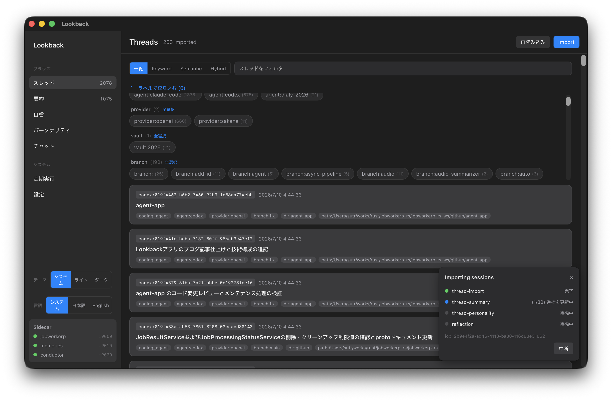

# Lookback

Lookback は、ローカルの Claude Code / Codex セッションログを検索可能な長期記憶として扱うための、クロスプラットフォーム Tauri デスクトップアプリです。

セッションログを [`memory-store`](https://github.com/jobworkerp-rs/memory-store) に取り込み、スレッド閲覧、要約、自省、パーソナリティ分析、RAG チャットをデスクトップ UI から利用できます。

英語ドキュメントは [README.md](README.md) を参照してください。開発者向けのセットアップ、テスト、環境変数の詳細は [docs/developer-guide_ja.md](docs/developer-guide_ja.md) に分離しています。

## スクリーンショット



## できること

- ローカルの `claude-code` / `codex` セッションログをインポート。
- ディレクトリ内のプレーンテキスト (`.md` / `.txt`) を、ファイルごと・ディレクトリごと・全体で 1 スレッドのいずれかにまとめてスレッドとしてインポート。
- インポート済みスレッドをスレッドグループまたは個別スレッドで閲覧し、キーワード検索、セマンティック検索、ハイブリッド検索、ラベル検索で検索。
- スレッドグループ、日次、週次、月次の要約を生成。スレッド単位の要約は期間・グループ要約を生成するための内部入力として扱います。
- 過去セッションから自省とパーソナリティプロファイルを生成。
- チャットタブからインポート済みの記憶に対する RAG 質問を実行。
- RAG 検索ツールを外部 MCP クライアントへ公開。
- 同梱 conductor バックエンドで定期インポートと要約タスクをスケジュール。

## 対応プラットフォーム

Lookback は Tauri が対応するデスクトップ環境を対象にします。現在のリポジトリは macOS と Linux のビルドを想定しています。

ローカル LLM 実行は現在 Qwen 3.5/3.6 系と Gemma 4 系のモデルのみに対応しています。Lookback はチャット前に要約を行うため、既定のローカル preset は非MTPの Gemma 4 E2B IT QAT です。MTP preset はチャット重視の用途向けに残し、Gemma 4 MTP では QAT 本体 GGUF に加えて draft GGUF も初期化時に指定します。その他のモデルファミリーを使う場合は外部 LLM プロバイダーを利用してください。

## 必要なコンポーネント

このリポジトリにはアプリ UI が含まれますが、デスクトップアプリ全体を動かすには同梱バックエンドバイナリと jobworkerp プラグインが必要です。

- [`jobworkerp`](https://github.com/jobworkerp-rs/jobworkerp-rs): `all-in-one`
- [`memory-store`](https://github.com/jobworkerp-rs/memory-store): `front` / `memories-import` /
  公式 SQLite migration bundle（`memories-db-migrate`、Atlas、migration catalog）
- [`jobworkerp-conductor`](https://github.com/jobworkerp-rs/jobworkerp-conductor): `conductor-main`
- [`issue-tracker-server`](https://github.com/sutr-app/issue-tracker-server): Issue Tracker sidecar
- runtime `protoc`: 自己完結した公式 protobuf コンパイラ。build 時に自動取得します（子プロセスが worker 登録時に
  runner スキーマをコンパイルするため実行時必須で、同梱バイナリとして配布します）
- [`llama-cpp-runner`](https://github.com/jobworkerp-rs/llama-cpp-runner): ローカル LLM ランナープラグイン
- [`mm-embedding-runner`](https://github.com/jobworkerp-rs/mm-embedding-runner): 埋め込み生成ランナープラグイン

フロントエンドの検査はこれらのバイナリなしでも実行できます。デスクトップアプリ全体の起動、ログインポート、モデルロード、配布パッケージのビルドには必要です。

### 起動時のデータベース移行

ローカルの memories データベースに移行が必要な場合、起動画面に「データベースの移行を確認・実行中」と表示されます。この表示中は処理の完了まで Lookback を終了または再起動しないでください。移行が不要な起動では確認だけで終わり、この表示は出ません。

移行前のバックアップ（設定 > 高度な設定）や、移行に失敗した場合の復元・再試行については [データベース移行の運用](docs/database-migration_ja.md) を参照してください。

## ソースからビルド

### 前提条件

ビルドホストに以下をインストールしてください。

- Rust edition 2024 に対応した Rust toolchain（rustc >= 1.85、`rustup` 経由）。
- Node.js と `pnpm`。
- 対象 OS 向け Tauri v2 の前提条件。
- バックエンドの各リポジトリとそのネイティブ依存が必要とするビルドツール:
  `git`、`cmake`、`pkg-config`、host `protoc`、`jq`、`curl` / `unzip` / `tar`。release build は protobuf compile と
  migration bundle 生成のため、host `protoc` と `jq` が `PATH` 上にあることを必要とします。これとは別に、
  runtime 同梱用の固定版・自己完結 `protoc` を build が download します。`PROTOC` は development staging の
  override に使えますが、release build の host `protoc` check の代わりにはなりません。
  - macOS: Xcode Command Line Tools（`xcode-select --install`）と、Homebrew で
    `brew install protobuf cmake pkgconf jq`。
  - Linux（Debian/Ubuntu）: `apt-get install -y build-essential git cmake pkg-config protobuf-compiler jq curl unzip tar`。
- Linux で CUDA ビルドを行う場合: CUDA toolkit（`nvcc`）。フルランタイムには `libcudnn` / `libnccl`。

### 自動ビルド（推奨）

`scripts/build-release.sh` は、6 つの公開バックエンドリポジトリを clone し、プラットフォームと
GPU バックエンドに応じた feature でビルドし、バイナリ / プラグイン / lindera 辞書に加えて
`front`と同じmemory-store checkoutから公式SQLite migration bundleを生成・配置したうえで
`pnpm tauri build` を実行します。

この release pipeline では、互換性上の名前 `memory-store` を公開 GitHub の [`memory-store` v0.0.19](https://github.com/jobworkerp-rs/memory-store/tree/v0.0.19)（peeled commit `8253e725708264592e131af3b92d1b4c7719054a`）に固定し、`front`、`memories-import`、migration CLI を同じ checkout からビルドします。Issue Tracker server は公開 GitHub の [`issue-tracker-server` v0.0.1](https://github.com/sutr-app/issue-tracker-server/tree/v0.0.1)（peeled commit `5974330a31ae19fb04db99841be73f305958d0d8`）を使います。source pin の検証と override は [開発者ガイド](docs/developer-guide_ja.md#リリースビルドの詳細) を参照してください。

```bash
# macOS（Metal GPU、DMG + .app）
scripts/build-release.sh --profile mac

# Linux（CUDA GPU、deb + AppImage）
scripts/build-release.sh --profile linux-cuda
```

便利なフラグ: `--skip-clone`（既存 clone を再利用）、`--only <repos>`（一部のみ再ビルド）、
`--workdir <dir>`（clone/ビルド先、既定 `.build-deps/`）、`--skip-frontend`、`--lindera skip`。
全オプションは `scripts/build-release.sh --help` を参照してください。`DRY_RUN=1` を前置すると
実行せずにコマンドだけ表示できます。

生成されるパッケージ（macOS の `.app` / DMG、Linux パッケージターゲットなど）には、
`src-tauri/tauri.conf.json` に従って UI、workers、任意の検索用辞書ファイル、プラグイン、
同梱バックエンドバイナリが含まれます。

### GitHub Actions でのリリースビルド

タグ push で起動する公開リポジトリの `.github/workflows/release.yml` は、test 成功後に macOS
署名付き DMG と Linux CUDA AppImage を並列 build し、CUDA 完了後に Linux CPU の deb / AppImage
を作成します。macOS は source provenance を検証してから `.app` と DMG を署名し、workflow が
DMG を notarize して検証した後に Release へ添付します。macOS 署名と notarization には、公開
リポジトリの GitHub Secrets に次の値を登録してください。

1. Keychain から `Developer ID Application` 証明書を秘密鍵付きの `.p12` として書き出します。
2. `.p12` を base64 化します。

   ```bash
   openssl base64 -A -in certificate.p12 -out certificate-base64.txt
   ```

3. GitHub Secrets に `APPLE_CERTIFICATE`（`certificate-base64.txt` の中身）、
   `APPLE_CERTIFICATE_PASSWORD`、`APPLE_SIGNING_IDENTITY`、`APPLE_ID`、`APPLE_PASSWORD`、
   `APPLE_TEAM_ID` を登録します。`APPLE_PASSWORD` は Apple ID の通常パスワードではなく、
   app-specific password を使います。

### 手動ビルド

バックエンドを自分でビルドする場合は、成果物を次のように配置して
`pnpm install && pnpm tauri:build` を実行します。

1. `src-tauri/bin/` に、Tauri が期待するターゲットトリプルのサフィックス付き
   （`-aarch64-apple-darwin`、`-x86_64-apple-darwin`、または Linux のターゲットトリプル。Windows は `.exe` も付加）で
   バックエンドバイナリを配置します。

   ```text
   src-tauri/bin/all-in-one-<triple>
   src-tauri/bin/front-<triple>
   src-tauri/bin/conductor-main-<triple>
   src-tauri/bin/issue-tracker-server-<triple>
   src-tauri/bin/memories-import-<triple>
   src-tauri/bin/protoc-<triple>
   ```

2. package build は開発用 staging や migration bundle の生成・再利用を行いません。通常の
   release では `scripts/build-release.sh` を使って、同じ pinned source から backend binary、
   migration bundle、provenance を生成・配置してください。手動で package する場合も、clean な
   pinned source の ref/revision と配置済み target-specific `front` / `memories-import` を
   `scripts/lib/write-migration-source-provenance.mjs` に渡して manifest を生成し、
   `pnpm verify:packaging-migration` を通す必要があります。`stage-dev-external-bins.sh` は開発用で、
   package 用 provenance の代わりにはなりません。開発時に配置される coding-agent パッケージも
   cargo target ディレクトリ配下にのみ置かれ、release bundle には含まれません。

   `pnpm tauri:build`、`pnpm tauri build` および直接の Tauri build/bundle は、provenance 欠損や
   `front` / `memories-import` の digest 不一致を packaging 前に拒否します。既存 staged bundle を
   先に削除せず、完全な pinned build と安全な staging には `scripts/build-release.sh` を使ってください。

3. ランナープラグイン（`libjobworkerp_llama_cpp_plugin` と `libmm_embedding_runner`）を対象 OS
   向けにビルドし、共有ライブラリを `plugins/` に配置します。macOS で Ruri ONNX を使う
   mm runner は、Qwen 用 Metal と ONNX 用 CoreML の両 feature を有効にします。

   ```bash
   cd /path/to/mm-embedding-runner
   cargo build --release --features metal,onnx-coreml
   cp target/release/libmm_embedding_runner.dylib \
     /path/to/agent-app/src-tauri/plugins/
   ```

   prefix 対応を含む `memories` の `front` も再ビルドして、Tauri の target triple 付き名称で
   配置します。

   ```bash
   cd /path/to/memories
   cargo build --release -p grpc-admin --bin front --features lindera
   cp target/release/front \
     /path/to/agent-app/src-tauri/bin/front-aarch64-apple-darwin
   ```
4. `memory-store` の `front` を Lindera FTS 対応でビルドする場合は、検索用辞書（`metadata.json`
   を含む lindera 3.x 形式）を `dict/lindera/ipadic` に配置します。Lookback はこのディレクトリを
   パッケージに含めて `memory-store` 用に配置しますが、辞書を直接読み込んで解析するわけではありません。

開発時の起動コマンドやパスの上書きは [docs/developer-guide_ja.md](docs/developer-guide_ja.md) を参照してください。

## 初回利用チュートリアル

1. Lookback を起動します。
2. セットアップウィザードを完了します。
   - データルートと Hugging Face キャッシュの場所を選びます。
   - ローカルまたは外部 LLM プロバイダーを選びます。
     - 外部 LLM の API キーは、Keychain など OS の認証情報ストアに保存されます。
   - 埋め込みモデルを選びます。日本語 UI の新規セットアップでは Ruri v3 310M INT8 ONNX
     が初期選択されます。既存設定や英語 UI の既定モデルは変更されません。
   - バックエンドとモデル準備状態の検査結果を確認します。
3. プロバイダー、モデルパス、キャッシュパス、言語、タイムゾーン、MCP 公開設定を変更したい場合は、後から **設定** を開きます。
   - Connection で memories を **Remote server** にする場合でも **Embedding model** は変更できます。Semantic / Hybrid 検索を使う場合は、ローカルで各記事の embedding は生成されないため、リモートサーバ側の embedding モデル・ベクトル次元と同じ設定に揃えます。memories が Remote の間の変更では、ローカル embedding インデックスのリセットや再生成は行いません。ローカル memories SQLite/LanceDB は起動・参照せず、すべての memories 読み書きはリモート endpoint を使います。接続時には gRPC Server Reflection で必要な memories service と一覧・件数 RPC の schema を検証するため、リモート側は summary の `memory_kinds` と `external_id_prefix` フィルタ、スレッドラベル RPC の `memory_kinds` フィルタを実装し、Reflection v1 を公開している必要があります。対応する更新済み memories バイナリを配布・設定してください。旧バイナリはこれらのフィールドを無視するため接続時に拒否され、各要約タブに異なる種別が混在しません。
   - **タイムゾーン** は、要約・インポート・タイムスタンプ表示で使う日付境界を制御します。**自動** はアプリの環境変数または OS のタイムゾーンに従います。明示的なタイムゾーンを保存すると、worker プロセスが起動時に `TZ` を読むため sidecar を再起動します。Connection で jobworkerp が **Remote server** の間は、リモート workflow がリモートサーバ側の環境を使うため、この設定は変更できません。
4. **スレッド** を開き、**インポート** から Claude Code または Codex のセッションログを取り込みます。ディレクトリ内のプレーンテキストを取り込む場合は、**プレーンテキスト (ディレクトリ)** をチェックし、対象ディレクトリを選択して、スレッド分割方法を選びます。
   - **ファイルごと**: 1 ファイル = 1 スレッド。
   - **ディレクトリごと**: 同じディレクトリ内のファイルを 1 スレッドにまとめる。
   - **全体で1つ**: ディレクトリ全体を 1 スレッドにする。

   プレーンテキストインポートは `.md` / `.txt` を再帰的に読み込みます。任意の **ソース名** (`a-z0-9_-`、32 字以内) を指定すると、インポート済みスレッドの名前空間プレフィックスになります（空の場合はインポーターの既定値を使用）。プレーンテキストは Claude Code / Codex と同じ実行でまとめて取り込めます。

   手動インポートでは `~/.claude/projects` と `~/.codex/sessions` をソースごとに確認し、選択したディレクトリが存在しないソースだけを除外します。選択した自動検出ログのソースが 1 つも利用できない場合も、インポートは成功（対象なし）として完了し、Threads上部の進捗パネルにその旨を表示します。プレーンテキストで指定したディレクトリが存在しない場合は、従来どおりエラーになります。regular の定期タスクもインポート前にソースごとに確認し、利用できない Codex / Claude Code のログルートは除外して `skipped_import_sources` に記録します。要約・生成の後続ステージは、ログルートが欠損していても設定どおり実行されます。
   インポート進捗にはスレッド要約とスレッドグループ要約が別の段階として表示され、どちらも処理中は現在件数と全体件数を表示します。グループ要約中も中断できます。その後にパーソナリティと自省が進みます。
5. **スレッド** でインポート済みスレッドを閲覧します。グループ表示ではアクティブなグループを選択し、系譜とグループ要約を確認できます。スレッドツリーの各カードの本文は、そのスレッド自身の要約です（グループ要約ではありません）。「起点のスレッド … を開く」などの操作から、それぞれの会話を開けます。削除済みメンバーは履歴として表示されますが開けません。グループ API に対応しない memories バージョンでは、画面に未対応状態が表示されます。
6. **要約** でスレッドグループ単位・期間単位の公開要約を生成または確認します。個別スレッド要約は内部処理にのみ使われ、一覧・検索・選択には表示されません。
7. **自省** と **パーソナリティ** で、インポート済みセッションから高次の観察結果を生成します。
8. **チャット** で過去の履歴に質問します。回答内のソースリンクから関連スレッドや要約を辿れます。
9. 定期的にインポートや要約を実行したい場合は **定期実行** を設定します。

## 同一スレッドの Issue 解決照合

試験的な Issue 機能を有効にした環境では、同じスレッドに後から追加された会話で既存の未確認 Candidate / 自動登録 Issue が完了・不要になったことを照合できます。人が確認・編集・claim した対象は自動変更しません。

1. **設定** → Issue の自動処理ポリシーで **Issue 解決照合モード**を `APPLY` に設定して保存します。新規 Candidate の抽出設定とは独立しています。
2. 新しいメッセージを取り込んでスレッド要約を更新します。既存要約の処理済みメッセージより後の追加がある場合だけ、要約保存後に照合します。初回要約・強制再要約だけでは自動照合しません。
3. スレッド詳細で結果を確認します。`結果未確認` は処理中とは限らず、アプリや jobworkerp の再起動でジョブが失われた場合も含みます。通常のジョブを再起動後に自動再送することはありません。
4. 結果が不明な場合は Tracker の Issue 状態を確認し、スレッド詳細の **Issue 解決を再評価**を押してください。この操作は要約を再生成せず、保存済み要約が処理した会話と現在の Issue 状態から判定し直します。新しい会話が要約後に追加されている場合は、先に要約を更新してください。`RESOLUTION_PENDING` の操作が残る対象は安全のため変更しません。操作 ID が不明な場合は、再試行前に設定済みの Issue Tracker で滞留中の操作を調査してください。

条件付き保存が利用できるようになるまで、同じスレッドの要約を複数の処理から同時に生成しないでください。
照合の入力窓に収まらない長文メッセージは途中で切って根拠にせず、その候補を変更しません。必要なら後続の短い明示的なメッセージで結果を確認し、要約を更新してください。

## MCP サーバ

Lookback は、Claude Desktop などの外部 MCP クライアント向けに RAG 検索機能を MCP サーバとして公開できます。MCP サーバは、通常の gRPC バックエンドと同じ `jobworkerp` sidecar 内で並行して動作するため、有効化してもアプリ内の閲覧、インポート、チャット機能は置き換わりません。

MCP で公開される範囲は合成用の `lookback-mcp` function-set に限定されます。既存の RAG 検索 tool と curated な `lookback_issue_*` tool を常に同じ一覧で公開します。

- `lookback_recall`: 生成済みのスレッドグループ／期間要約とインポート済みの元メッセージの両方から、過去の会話、判断、作業履歴を検索します。個別スレッド要約は内部入力のため検索結果には含まれません。
- `lookback_get_context`: memory/thread の ID を指定して、選択したメッセージや記憶を取得します。
- `lookback_get_reflections`: 選択した thread の最新 reflection を取得します。
- `lookback_issue_get` / `lookback_issue_list` / `lookback_issue_list_ready` / `lookback_issue_create` / `lookback_issue_update` / `lookback_issue_add_comment` / `lookback_issue_add_relation` / `lookback_issue_remove_relation` / `lookback_issue_transition` / `lookback_issue_claim` / `lookback_issue_heartbeat` / `lookback_issue_release`

MCP クライアントの tool 一覧では、GRPC worker の method 接尾辞が付きます（例: `lookback_issue_create___unary`）。

Issue Tracker が利用不能でも、MCP クライアントの tool cache が起動ごとに変わらないよう tool 一覧は維持されます。この状態では RAG tool は利用でき、`lookback_issue_*` の呼出しだけが Tracker の接続エラーになります。Lookback 左下の Sidecar 一覧で利用不能状態を確認し、**設定** → **ログ** → `issue-tracker` で server 出力を確認してください。Lookback を再起動しても回復しない場合は、そのログを保存して原因を調査します。

有効化手順:

1. **設定** を開きます。
2. 通常は **MCP Server** で認証トークンを生成し、ただちにコピーします。生成済みトークンは一度だけ表示され、サーバ起動時に自動生成されません。
   Bearer 認証の導入前に有効化していた MCP 設定は、更新時に一度だけ無効化されます。トークンを生成してから、あらためて有効化してください。
   閉域環境で試す場合だけ、**MCP auth tokenなしのリクエストを許可する** を有効にできます。この場合は Bearer 認証が完全に無効になり、接続先 endpoint に到達できるすべてのクライアントが利用できます。token は不要で、既に保存済みの token があっても使われません。
3. **MCP Server** でサーバを有効にします。
4. 設定を保存します。MCP は sidecar 起動時に設定されるため、Lookback は sidecar を再起動します。
5. 表示された接続先 URL をコピーします。通常の優先ローカル URL は次の形式です。

```text
http://127.0.0.1:39010/mcp
```

このポートが使用中の場合、Lookback は別の空きポートを選び、実際の URL を設定画面に表示します。

6. streamable HTTP transport として MCP クライアントに URL とコピーした Bearer トークンを登録します。クライアント設定例:

```json
{
  "mcpServers": {
    "lookback": {
      "url": "http://127.0.0.1:39010/mcp",
      "headers": {
        "Authorization": "Bearer <コピーしたトークン>"
      }
    }
  }
}
```

無認証を許可した場合は `headers` を省略します。

```json
{
  "mcpServers": {
    "lookback": {
      "url": "http://127.0.0.1:39010/mcp"
    }
  }
}
```

Lookback がリモートの `memory-store` を参照する設定の場合、MCP 検索も可能な範囲で同じ有効な記憶接続先を使います。リモート URL が不正または未設定の場合、RAG workflow はローカル sidecar の記憶エンドポイントにフォールバックします。

## アプリデータ

Lookback の永続データは OS のアプリケーションデータディレクトリに保存されます。代表的な既定値は次のとおりです。

```text
macOS: ~/Library/Application Support/lookback/
Linux: ~/.local/share/lookback/
```

このルートには SQLite / LanceDB データ、配置済みプラグイン、モデルキャッシュ設定、バックエンドプロセスログ、接続設定、孤立プロセスのクリーンアップ用 PID ファイルが含まれます。設定画面からデータルートを消去できます。

## 関連ドキュメント

- [README.md](README.md): 英語 README。
- [docs/developer-guide_ja.md](docs/developer-guide_ja.md): 開発者ガイド。
- [workers/README.md](workers/README.md): worker / workflow YAML bundle。
